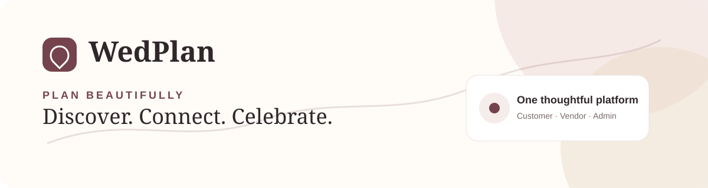
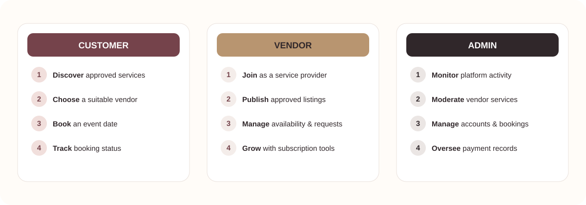
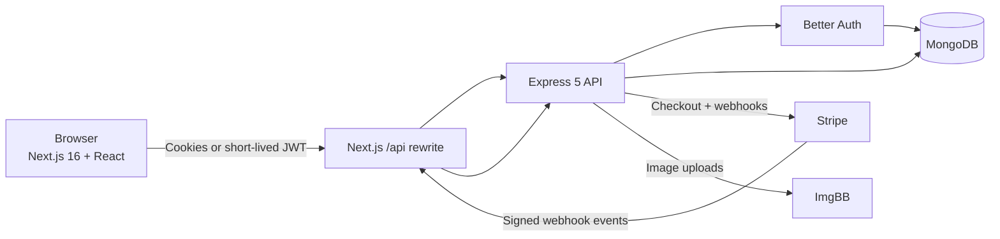

# WedPlan

<p align="center">
  
</p>

<p align="center">
  <strong>Plan beautifully. Connect confidently. Celebrate completely.</strong>
</p>

<p align="center">
  <a href="https://wedplan-client-ten.vercel.app"><strong>Live application</strong></a>
  ·
  <a href="#quick-start"><strong>Local setup</strong></a>
  ·
  <a href="#features-by-role"><strong>Features</strong></a>
  ·
  <a href="https://github.com/afiaafia/wedplan-server"><strong>Server repository</strong></a>
</p>

WedPlan is a role-aware wedding planning platform for couples, vendors, and administrators. Couples discover approved wedding services and request bookings, vendors publish listings and manage requests, and administrators oversee users, moderation, bookings, and verified payment records.

| Live | Repository | Backend |
| --- | --- | --- |
| [wedplan-client-ten.vercel.app](https://wedplan-client-ten.vercel.app) | [afiaafia/wedplan-client](https://github.com/afiaafia/wedplan-client) | [afiaafia/wedplan-server](https://github.com/afiaafia/wedplan-server) |

---

## Project preview


---

## How WedPlan works

### One platform. Three experiences.

<p align="center">
  
</p>

### Customer journey

1. **Discover** — Browse approved services and filter by category, location, or price.
2. **Choose** — Open a service detail page and review the listing and vendor.
3. **Book** — Submit an event date, location, and optional message.
4. **Track** — View booking status and pending-booking history, and cancel eligible requests.

### Vendor journey

1. **Join** — Register or add Vendor capability to an existing account.
2. **Publish** — Create a service and submit it for Admin approval.
3. **Manage** — Control availability and accept or reject booking requests.
4. **Grow** — Review plan state and start Stripe Checkout for Premium when available.

### Admin journey

1. **Monitor** — Review platform-wide and recent activity.
2. **Moderate** — Approve or reject vendor listings.
3. **Manage** — Search accounts and use protected block/unblock controls.
4. **Oversee** — Inspect bookings and read-only transaction records.

---

## Features by role

### Customer

- Public service browsing, search, filtering, sorting, pagination, and service details
- Authenticated booking requests with duplicate and future-date safeguards
- Customer booking dashboard, booking detail, and pending-request cancellation
- Profile and profile-image management
- Email/password and Google sign-in

### Vendor

- Vendor registration and multi-role account support
- Service creation, editing, deletion, image upload, and availability controls
- Free-plan active-service limit and Premium subscription state
- Vendor booking list/detail and accept/reject actions
- Stripe Checkout entry point and payment return handling

### Admin

- Database-backed platform statistics and recent activity
- User search, role filtering, account-status filtering, details, and block/unblock controls
- Vendor-aware service search and review
- Approval/rejection, activation/deactivation, and deletion controls
- Read-only booking oversight and transaction detail views

---

## Technology stack

| Layer | Technology |
| --- | --- |
| Framework | Next.js 16.4.6, App Router, React 19.3 |
| Language | TypeScript 5 |
| Styling | Tailwind CSS 4.3 |
| Motion | Framer Motion 14 |
| Icons | Lucide React 1.74, React Icons 5 |
| Authentication | Better Auth 1.7.25 |
| Data access | Authenticated frontend API clients |
| Validation | TypeScript assertions and backend Zod validation |
| Testing | Node.js test runner with TypeScript stripping |
| Package manager | pnpm 12.4.2 |

## Architecture



Browser authentication primarily uses Better Auth cookies. The client can also request an in-memory short-lived JWT for protected API calls; the server revalidates the current user, role, and blocked state.

---

## Quick start

### Prerequisites

- Node.js 24-compatible runtime
- pnpm 12.4.2
- A running WedPlan server
- MongoDB and backend credentials for full application data

### Install and run

```bash
git clone https://github.com/afiaafia/wedplan-client.git
cd wedplan-client
pnpm install
cp .env.example .env.local
```

Set the local environment values, then start the client:

```bash
pnpm dev
```

Open `http://localhost:3000`.

---

## Environment variables

Create `.env.local` from `.env.example`.

| Variable | Required | Purpose |
| --- | --- | --- |
| `NEXT_PUBLIC_API_URL` | Yes locally | Public API origin; `http://localhost:5000` locally |
| `NEXT_PUBLIC_BETTER_AUTH_URL` | Yes locally | Better Auth origin; `http://localhost:5000` locally |
| `NEXT_PUBLIC_SITE_URL` | Recommended | Frontend origin used in OAuth and redirects |
| `API_INTERNAL_URL` | Yes locally | Server-only API origin used by Next.js rewrites and server components |
| `NEXT_PUBLIC_CONTACT_EMAIL` | Optional | Footer contact email |
| `NEXT_PUBLIC_INSTAGRAM_URL` | Optional | Validated HTTP(S) Instagram profile URL |
| `NEXT_PUBLIC_FACEBOOK_URL` | Optional | Validated HTTP(S) Facebook profile URL |
| `NEXT_PUBLIC_PINTEREST_URL` | Optional | Validated HTTP(S) Pinterest profile URL |
| `NEXT_PUBLIC_X_URL` | Optional | Validated HTTP(S) X profile URL |

`NEXT_PUBLIC_*` values are browser-visible. Never put secrets in them.

In production, keep browser-facing auth/API values on the frontend origin and set `API_INTERNAL_URL` to the Render API origin:

```dotenv
NEXT_PUBLIC_API_URL=https://wedplan-client-ten.vercel.app
NEXT_PUBLIC_BETTER_AUTH_URL=https://wedplan-client-ten.vercel.app
NEXT_PUBLIC_SITE_URL=https://wedplan-client-ten.vercel.app
API_INTERNAL_URL=https://wedplan-server-vcdp.onrender.com
```

---

## Project structure

```text
src/
├── app/                         # Public, auth, and role-protected routes
├── components/
│   ├── auth/                    # Sign-in and sign-up experiences
│   ├── dashboard/               # Customer, vendor, and admin dashboards
│   ├── home/                    # Homepage sections
│   ├── layout/                  # Navbar, footer, theme, and toast UI
│   └── services/                # Discovery, details, and booking UI
├── lib/                         # API clients and auth/filter utilities
└── proxy.ts                     # Dashboard route and role guard
tests/                           # Frontend API and helper tests
docs/                            # QA screenshots and README assets
public/                          # Static public assets
```

---

## Quality and testing

```bash
pnpm typecheck
pnpm lint
pnpm test
pnpm build
```

| Command | Purpose |
| --- | --- |
| `pnpm typecheck` | Run TypeScript without emitting files |
| `pnpm lint` | Run ESLint |
| `pnpm test` | Run the configured Node.js test suite |
| `pnpm build` | Create the production Next.js build |

The frontend test suite is a source-level and API-contract suite. It does not by itself prove real authenticated browser journeys or live Stripe payments.

## Deployment

The client is deployed on Vercel at [wedplan-client-ten.vercel.app](https://wedplan-client-ten.vercel.app).

The Next.js application proxies `/api/*` requests to the configured API backend. This allows browser sessions and OAuth callbacks to remain on the Vercel origin while forwarding requests to Render.

The backend Google authorized redirect URI must match the deployed callback:

```text
https://wedplan-client-ten.vercel.app/api/auth/callback/google
```

---

## Related resources

- [WedPlan Server](https://github.com/afiaafia/wedplan-server)
- [Production API](https://wedplan-server-vcdp.onrender.com)
- [API health endpoint](https://wedplan-server-vcdp.onrender.com/api/health)
